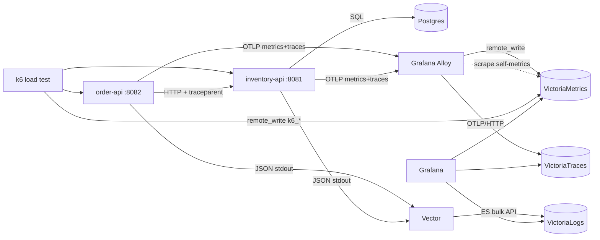

# O11y Lab

A containerized observability playground: two instrumented Go services generate
metrics, traces and logs. Alloy and Vector collect them into VictoriaMetrics,
VictoriaLogs and VictoriaTraces, and Grafana shows all three.



| Signal  | Path |
|---------|------|
| Metrics | app OTel SDK → OTLP gRPC → **Alloy** → Prometheus remote write → **VictoriaMetrics** |
| Traces  | app OTel SDK → OTLP gRPC → **Alloy** → OTLP/HTTP → **VictoriaTraces** |
| Logs    | app `slog` JSON on stdout (with `trace_id`/`span_id`) → **Vector** `docker_logs` → **VictoriaLogs** |
| Stack metrics | Alloy scrapes Alloy, Vector, VictoriaMetrics, VictoriaLogs, VictoriaTraces and Grafana |

## Quick start

```bash
make up          # docker compose up -d --build
make smoke       # functional + telemetry smoke test (~30-60s)
make load        # k6 steady load, 3 min   (DURATION=10m make load)
make stress      # k6 ramping stress, ~6 min
make spike       # k6 spike, ~2 min
make down        # stop (keep data)   |   make nuke  # stop + wipe volumes
```

> **Docker CLI note:** on this machine `/usr/local/bin/docker` is a broken
> symlink left over from an OrbStack install. Either fix it
> (`sudo ln -sf /Applications/Docker.app/Contents/Resources/bin/docker /usr/local/bin/docker`),
> put `/Applications/Docker.app/Contents/Resources/bin` first in your `PATH`, or run
> `make up DOCKER=/Applications/Docker.app/Contents/Resources/bin/docker`.

## URLs

| What | URL |
|------|-----|
| Grafana (anonymous admin) | http://localhost:3300 → dashboard **O11y Lab → Services overview** |
| VictoriaMetrics vmui | http://localhost:8428/vmui |
| VictoriaLogs UI | http://localhost:9428/select/vmui |
| VictoriaTraces UI | http://localhost:10428/select/vmui |
| Alloy pipeline UI | http://localhost:12345 |
| Vector API | http://localhost:8686/health (`docker compose exec vector vector top`) |
| inventory-api | http://localhost:8081 |
| order-api | http://localhost:8082 |
| OTLP ingest (for your own experiments) | gRPC `localhost:4317`, HTTP `localhost:4318` |

You can change any host port in [.env](.env). Grafana uses **3300** because
another process already listens on 3000.

## Services

### inventory-api (Postgres CRUD)

| Method | Path | Notes |
|--------|------|-------|
| GET | `/healthz` | pings DB |
| GET | `/items` | list (max 100) |
| POST | `/items` | `{"sku","name","price","stock"}` |
| GET / PUT / DELETE | `/items/{id}` | PUT body: `{"name","price","stock"}` |
| POST | `/items/{id}/reserve` | `{"quantity"}`. Runs a transaction with `SELECT … FOR UPDATE`. Returns 409 if stock is too low |

Schema and 5 seed items are created on startup.

### order-api (calls inventory-api)

| Method | Path | Notes |
|--------|------|-------|
| GET | `/catalog` | proxies `GET /items` |
| POST | `/orders` | `{"item_id","quantity"}` → GET item → validate → reserve (retries 5xx) |
| GET | `/orders`, `/orders/{id}` | in-memory orders |

### Telemetry produced

- **Traces:** server spans named after the route (`POST /orders`), client spans
  for order-api → inventory-api with W3C trace-context propagation, `database/sql`
  spans (`sql.conn.query`, `sql.tx.commit`, …), and custom spans
  (`order.validate`, `inventory.reserve`).
- **Metrics:** `http_server_request_duration_seconds`,
  `http_client_request_duration_seconds`, `db_client_operation_duration_seconds`,
  `db_sql_connection_*`, Go runtime `go_*`, and business metrics
  `orders_created_total{outcome}`, `orders_value_USD`,
  `inventory_items_reserved_total`, `inventory_reservations_rejected_total`.
  Resource attributes become labels (`service_name`, `deployment_environment`, …).
- **Logs:** JSON access logs and domain events. Each one has `trace_id`/`span_id`.
  In Grafana, a log line's `trace_id` links to the trace, and a trace links back to
  `trace_id:"…"` logs.

### Chaos knobs

Each service randomly injects latency and 503s so the dashboards show realistic
behavior. You can tune this in [.env](.env) and then run `make up`:

```
INVENTORY_CHAOS_ERROR_RATE=0.02   INVENTORY_CHAOS_MAX_LATENCY_MS=50
ORDER_CHAOS_ERROR_RATE=0.01       ORDER_CHAOS_MAX_LATENCY_MS=30
```

## Tests

- [scripts/smoke.sh](scripts/smoke.sh) checks:
  1. All 8 components are healthy.
  2. inventory-api CRUD works, including the 400, 404 and 409 paths.
  3. The order flow works end to end.
  4. Telemetry arrived. It sends a request with a known `traceparent`, then asserts the
     trace contains spans from both services, the matching log lines are in VictoriaLogs,
     and the metrics (app, DB, business and stack `up`) are in VictoriaMetrics.

  Use `--no-telemetry` to skip step 4. Override the target URLs with env vars
  (`INVENTORY_URL`, `ORDER_URL`, `VM_URL`, …).
- [scripts/stress.sh](scripts/stress.sh) `[load|stress|spike]` runs
  [loadtest/load.js](loadtest/load.js) with k6 inside the compose network. Three
  scenarios run in parallel: an order flow, an inventory CRUD loop, and a restocker
  that keeps the seed items from running out. k6 also remote-writes `k6_*` metrics
  into VictoriaMetrics, so the dashboard shows the client view next to the server view.
  Extra k6 args are passed through, e.g. `scripts/stress.sh load --vus 50`.

## Layout

```
docker-compose.yml          whole stack (+ k6 under the "loadtest" profile)
.env                        host ports + chaos knobs
apps/                       Go module (one image per service via ARG SERVICE)
  cmd/inventory-api/        Postgres CRUD service
  cmd/order-api/            orchestrator calling inventory-api
  internal/telemetry/       OTel SDK setup + trace-aware slog JSON logger
  internal/httpx/           router, access log, chaos, JSON helpers
config/alloy/config.alloy   OTLP receiver → VM / VT / VL, self-scrapes
config/vector/vector.yaml   docker_logs → parse JSON → VictoriaLogs
config/grafana/             datasource + dashboard provisioning
loadtest/load.js            k6 scenarios (load / stress / spike)
scripts/                    smoke.sh, stress.sh
```

## Pinned versions

VictoriaMetrics v1.154.1, VictoriaLogs v1.53.0, VictoriaTraces v0.12.0,
Alloy v1.21.0, Vector 0.60.0, Grafana 13.2.4, Postgres 17, k6 1.8.2, Go 1.26,
OpenTelemetry Go v1.47.0.
